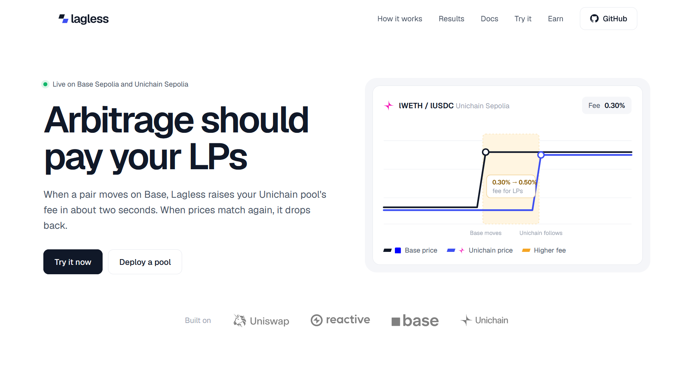

<p align="center">
  <picture>
    <source media="(prefers-color-scheme: dark)" srcset="brand/lagless-lockup-dark.svg">
    
  </picture>
</p>

<h3 align="center">Arbitrage should pay your LPs</h3>

<p align="center">
  Lagless raises a Uniswap v4 pool's fee on Unichain about two seconds after the same pair moves on Base,<br>
  then lowers it again when prices match. Fully on-chain, powered by Reactive Network.
</p>

<p align="center">
  <a href="https://lagless.sithunyein.com"><b>Website</b></a> ·
  <a href="https://lagless.sithunyein.com/app/"><b>Try it</b></a> ·
  <a href="https://youtu.be/jL_Hv-3811w"><b>Demo video</b></a> ·
  <a href="#how-it-works">How it works</a> ·
  <a href="#results">Results</a> ·
  <a href="#deploy-testnets-0">Deploy</a> ·
  <a href="#deployed-addresses-and-transactions">Contracts</a>
</p>

<p align="center">
  <a href="https://lagless.sithunyein.com"></a>
</p>

<p align="center">
  <a href="https://github.com/thesithunyein/lagless/actions/workflows/test.yml"></a>
  <a href="#results"></a>
  <a href="#results"></a>
  <a href="#results"></a>
  <br>
  
  
  
  
  
  <a href="LICENSE"></a>
</p>

## For judges

| Requirement | Where |
|---|---|
| Public, open-source repo (MIT) | this repository |
| Track | **Every Second Counts** (Base Sepolia → Reactive Omni → Unichain Sepolia) |
| Deployed contracts | [Deployed addresses](#deployed-addresses-and-transactions) |
| Full loop, origin event → callback | [Latest loop (v2)](#latest-live-loop-v2-nov-21-2026) and [first loop (v1)](#first-live-loop-nov-17-2026); every round's hashes in [`results.csv`](results.csv) |
| Demo video (under 3 min) | [youtu.be/jL_Hv-3811w](https://youtu.be/jL_Hv-3811w) |
| Working demo | [lagless.sithunyein.com/app](https://lagless.sithunyein.com/app/): connect a wallet, move the Base price, watch the Unichain fee rise, trade |
| For LPs | [lagless.sithunyein.com/lp](https://lagless.sithunyein.com/lp/): add liquidity to the Lagless pool as a real Uniswap v4 position (official PositionManager), see fees earned vs a normal 0.30% pool, collect or remove |
| Tests | `forge test`: 20 passing, also run in GitHub Actions |
| Built during the event | first commit Nov 17, 2026; full history in this repo |
| Timers use timestamps, not blocks | every shield expires by `block.timestamp` (Base Sepolia's 200 ms blocks don't affect it) |

## Problem

The same pair trades on Base and Unichain. When the price moves on Base, the Unichain pool keeps quoting the old price until someone arbitrages it. That gap is profit for the arbitrageur, paid by LPs (loss-versus-rebalancing, LVR).

## How it works

```
Base Sepolia                     Reactive Omni (Lasna)                 Unichain Sepolia
────────────                     ────────────────────────                 ────────────────
v4 pool ──Swap(sqrtPriceX96)──▶  LaglessReactive.react()                  
                                 • decode Base price                      
                                 • deviation vs Unichain price (bps)      
                                 • fee = min(max, base + slope × dev)     
                                 • emit Callback ───────────────────────▶ LaglessHook.setShield()
                                                                          • fee raised, renewed until prices match
                                                                          • beforeSwap returns fee | OVERRIDE
Lagless pool ◀──Swap──────────── (arbitrage on Unichain)                  
             ──Swap(sqrtPriceX96)▶ react(): prices converged? ──────────▶ LaglessHook.clearShield()
```

- **All decisions happen in the reactive contract**: decoding prices, measuring deviation, choosing the fee, and deciding when to refresh or clear.
- **The fee stays up until prices match.** Each raise lasts 60 s; the reactive contract renews it while the gap is still open and clears it the moment prices converge. Waiting it out doesn't help an arbitrageur.
- **The hook stays small.** It accepts calls only from the Reactive callback proxy, and only when Reactive Omni has stamped the payload with the LaglessReactive contract's address. It caps the fee and the shield's duration, and lets shields expire by `block.timestamp`, never by block count.
- **Built for Reactive Omni.** `react()` is called directly by the Omni system contract (`0x8888…8888`, guarded by `onlySystem`; no ReactVM), subscriptions and callbacks go through that system contract (`requestCallbackV_1_0`), and fees are prepaid into the contract's Omni reserves. `src/omni/ReactiveOmni.sol` holds ABI-compatible bindings for solc 0.8.26, because `reactive-lib-omni` requires ^0.8.29 while Uniswap v4 pins 0.8.26.
- **A control pool** (same pair, static 0.30%, no hook) on Unichain is the baseline for the results.

With the old ~7s Reactive blocks, the fee would land after the arbitrage. With Omni's ~1s blocks and instant finality, it lands while the stale window is still open.

**Limitation:** a very fast arbitrageur can still trade before the callback lands. Lagless shrinks the free window and makes the rest of it more expensive; it does not claim to block arbitrage.

## Contracts

| Contract | Chain | Role |
|---|---|---|
| `src/LaglessReactive.sol` | Reactive Omni (Lasna) | Subscribes to `Swap` on both pools and makes all fee decisions |
| `src/omni/ReactiveOmni.sol` | — | Minimal Reactive Omni system-contract bindings (solc 0.8.26) |
| `src/LaglessHook.sol` | Unichain Sepolia | v4 dynamic-fee hook (`beforeInitialize`, `beforeSwap`) |
| `src/test/MockToken.sol` | Base + Unichain Sepolia | Open-mint test tokens, deployed with CREATE2 so both chains get the same addresses |

## Parameters (`script/Config.sol`)

| Parameter | Value |
|---|---|
| Base fee | 0.30% (3000 pips) |
| Max shield fee | 1.00% |
| Trigger | 20 bps price gap |
| Slope | +50 pips per bp of gap |
| Clear | gap ≤ 5 bps |
| Shield duration | 60 s per raise, renewed while prices stay apart, cleared when they match; hard cap 120 s on the hook |

## Run the tests

```bash
forge install   # or: git submodule update --init --recursive
forge test -vv
```

There are 20 tests covering the fee curve, caps, expiry, renewal of a raise while prices stay apart, rejection of unauthorized callers and wrong reactive senders, the one-time `setReactive` binding, `onlySystem` on `react()`, rejection of static-fee pools, a fuzz test on the fee cap, and a local end-to-end loop (Base move → reactive callback → higher fee on Unichain → convergence → fee cleared).

## Deploy (testnets, $0)

You need a **dev-only** wallet funded on Base Sepolia, Unichain Sepolia and Reactive Lasna (lREACT). Copy `.env.example` to `.env`, fill it in, then `source .env`.

```bash
# 1. Tokens (same addresses on both chains)
forge script script/Deploy.s.sol:DeployTokens --rpc-url $BASE_SEPOLIA_RPC --private-key $PRIVATE_KEY --broadcast
forge script script/Deploy.s.sol:DeployTokens --rpc-url $UNICHAIN_SEPOLIA_RPC --private-key $PRIVATE_KEY --broadcast
#    → set TOKEN_A, TOKEN_B

# 2. Base source pool → set BASE_POOL_ID
forge script script/Deploy.s.sol:DeployBasePool --rpc-url $BASE_SEPOLIA_RPC --private-key $PRIVATE_KEY --broadcast

# 3. Hook + Lagless pool + control pool on Unichain → set HOOK, LAGLESS_POOL_ID, CONTROL_POOL_ID
#    Start the pool at the Base price, and the hook gets 0.0005 ETH for callback fees (HOOK_FUNDING_WEI)
export INIT_SQRT_PRICE_X96=$(python3 script/base_price.py | sed -n 's/^INIT_SQRT_PRICE_X96=//p')
forge script script/Deploy.s.sol:DeployUnichain --rpc-url $UNICHAIN_SEPOLIA_RPC --private-key $PRIVATE_KEY --broadcast

# 4. Reactive contract on Reactive Omni, prepaid with OMNI_RESERVE_WEI (default 0.1 lREACT) → set REACTIVE
forge script script/Deploy.s.sol:DeployReactive --rpc-url $LASNA_RPC --private-key $PRIVATE_KEY --broadcast --with-gas-price 101gwei --priority-gas-price 1gwei

# 5. Bind the hook to the reactive contract (one-time)
forge script script/Deploy.s.sol:SetReactive --rpc-url $UNICHAIN_SEPOLIA_RPC --private-key $PRIVATE_KEY --broadcast
```

If the reactive contract's subscriptions show **INACTIVE** on Reactscan, the contract has debt on the **Omni** ledger (`0x8888…8888`). Top up its Omni reserves; `depositTo` settles the debt first:

```bash
cast send 0x8888888888888888888888888888888888888888 "depositTo(address)" $REACTIVE --value 0.1ether --rpc-url $LASNA_RPC --private-key $PRIVATE_KEY
```

Note: depositing to the legacy service `0x…fffFfF` or calling `coverDebt()` (reactive-lib's default vendor) does **not** clear Omni-era debt.

## Run a live round

```bash
# Move the Base price (leading venue)
POOL=base AMOUNT=50000000000000000000 ZERO_FOR_ONE=true \
  forge script script/Swap.s.sol:Swap --rpc-url $BASE_SEPOLIA_RPC --private-key $PRIVATE_KEY --broadcast

# Measure Base swap → Unichain ShieldRaised (prints a CSV row)
python3 script/latency.py <base_swap_tx_hash>

# Arbitrage both Unichain pools and compare
POOL=lagless AMOUNT=... ZERO_FOR_ONE=true forge script script/Swap.s.sol:Swap --rpc-url $UNICHAIN_SEPOLIA_RPC --private-key $PRIVATE_KEY --broadcast
POOL=control AMOUNT=... ZERO_FOR_ONE=true forge script script/Swap.s.sol:Swap --rpc-url $UNICHAIN_SEPOLIA_RPC --private-key $PRIVATE_KEY --broadcast
```

## Live rounds (automated)

`script/rounds.py` runs full rounds and appends one row per round to `results.csv`: Base move → wait for the shield on Unichain (latency) → the same arbitrage trade on the Lagless pool and on the control pool (LP fee collected by each).

```bash
python3 script/rounds.py --sync 150   # one-time: align the Unichain pools with the Base price
python3 script/rounds.py 20           # 20 rounds, alternating direction
python3 script/rounds.py 10 --race    # arbitrage fires right after the Base move (fast bot)
python3 script/export_rounds.py       # refresh web/rounds.json for the website
```

It signs with the Foundry keystore account `lagless` and asks for the password once per run.

## Deployed addresses and transactions

| Item | Address / tx |
|---|---|
| Tokens lWETH / lUSDC (same address on Base + Unichain Sepolia) | `0x9063cE4EBFBA81206E621158B7586024eeC6d0B3` / `0x41eFe7a3A065a5094Eb88c9F486238Fc227E7893` |
| Base Sepolia source pool id | `0xba49af2a7fd75f159181a85b3a2dabff571a9ea24eba7cc3bf943f5d9b512ffd` |
| LaglessReactive (Reactive Omni, Lasna) | [`0xaACb71b1A18bDb107C580F040c9D6c1105968bE5`](https://lasna.reactscan.net/address/0xaACb71b1A18bDb107C580F040c9D6c1105968bE5) |
| LaglessHook (Unichain Sepolia) | [`0x4e1EDAF301465C9f9BD30f73bc174a18D2F12080`](https://sepolia.uniscan.xyz/address/0x4e1EDAF301465C9f9BD30f73bc174a18D2F12080) |
| Lagless pool id (Unichain, dynamic fee) | `0x09f473aae7534b017312c177d01dbf26fea9c71e7ca2d5e1815ae79f57c0ffeb` |
| Control pool id (Unichain, static 0.30%) | `0xba49af2a7fd75f159181a85b3a2dabff571a9ea24eba7cc3bf943f5d9b512ffd` |

**Version 1** (10-second raises; rounds 1–34 and the first live loop below): LaglessReactive [`0x1eee3853d5C0dEB9702eC4e7EEd205ff58d878e5`](https://lasna.reactscan.net/address/0x1eee3853d5C0dEB9702eC4e7EEd205ff58d878e5), LaglessHook [`0x03A696938EF795a0B1496FC407CF7B53F4702080`](https://sepolia.uniscan.xyz/address/0x03A696938EF795a0B1496FC407CF7B53F4702080), pool `0x5c20493e45711a98dd4fd618626e5dd17b13d3c3d68690c9a4c7c70460bcbfd9`. Version 2 keeps the fee raised until prices match, so a bot can no longer wait out a short window.

### Latest live loop (v2, Nov 21, 2026)

Round 40 in `results.csv`, on the current contracts:

| Step | Chain | Tx | Block time |
|---|---|---|---|
| 1. Swap moves the price | Base Sepolia | [`0xf14b2f14…dd90be`](https://sepolia.basescan.org/tx/0xf14b2f14c1a4d1162e893b98cd743469da8352a8503007d19eb8f2b81edd90be) | 1795275353 |
| 2. `react()` decides, requests callback | Reactive Omni | [`0xc6a42fb3…c44954`](https://lasna.reactscan.net/tx/0xc6a42fb38ff410ca694163d99f66fafdde39ee195a15187ed541af52cbc44954) | 1795275352 |
| 3. `setShield` raises the LP fee to 0.49% | Unichain Sepolia | [`0x948eda10…7fdf07`](https://sepolia.uniscan.xyz/tx/0x948eda10ac885e0ce81395d16d21451697d60fa1b7f1c2965ca200b9877fdf07) | 1795275356 |
| 4. Arbitrage on the Lagless pool pays 0.49% | Unichain Sepolia | [`0xb008b8bd…6bb7f2`](https://sepolia.uniscan.xyz/tx/0xb008b8bd13704bcb3b414d6998501f3e011fce126dcd3fcd293f1139576bb7f2) | |
| 5. Same trade on the control pool pays 0.30% | Unichain Sepolia | [`0xf7d7a130…881b06`](https://sepolia.uniscan.xyz/tx/0xf7d7a130a5b57b751f19b7943551fd55581b42aeffa25a276937b5311e881b06) | |
| 6. Prices match, `react()` requests `clearShield` | Reactive Omni | [`0x0a36c507…380fbd`](https://lasna.reactscan.net/tx/0x0a36c507d3674db36d1e169560103bde880a0e703e95cb18b0e440b42d380fbd) | 1795275361 |
| 7. `clearShield` returns the fee to 0.30% | Unichain Sepolia | [`0xfc46c094…3d5756`](https://sepolia.uniscan.xyz/tx/0xfc46c094dbd520dab0edb16fe244aed996f90f3511b13a15b0a7bb4e973d5756) | |

Base swap → Unichain fee change: **3 s**. Reactive Omni's clock runs about 1 s behind Base, so step 2 shows an earlier timestamp than step 1.

### First live loop (Nov 17, 2026)

| Step | Chain | Tx | Block time |
|---|---|---|---|
| 1. Swap moves the price | Base Sepolia | [`0x4a7debcf…fd0a2b`](https://sepolia.basescan.org/tx/0x4a7debcfbb53a749d61c496c76f26bc7bac32b839cf79064dadd33c648fd0a2b) | 1794911210 |
| 2. `react()` decides, requests callback | Reactive Omni | [`0xedc886a7…420f9f`](https://lasna.reactscan.net/tx/0xedc886a79064459e38ec3e2372d8fd51c024054065f8bfdad268726178420f9f) | 1794911210 |
| 3. `setShield` raises the LP fee to 1.00% | Unichain Sepolia | [`0x77ec25f3…d2480`](https://sepolia.uniscan.xyz/tx/0x77ec25f373f91e53071b8ca7162e940ad0ee758d0bcbb66dfe366737d65d2480) | 1794911212 |

Base swap → Unichain fee change: **2 s** (block timestamps, 1 s resolution).

## Results

24 live rounds on testnet (Nov 17, 2026), `script/rounds.py`, 20-token swaps alternating direction:

| Metric | Result |
|---|---|
| Rounds where the shield landed | **24 / 24** |
| Base swap → Unichain fee change (median) | **2 s** |
| Latency distribution | 1 s ×1, 2 s ×14, 3 s ×8, 4 s ×1 (block timestamps, 1 s resolution) |
| Shield fee for a ~0.4% Base move | 0.495–0.50% (vs 0.30% base) |
| LP fees from the same arbitrage trades | **2.388** (Lagless) vs **1.440** (control) → **+66%** |

### Version 2: fee stays up until prices match (Nov 21, 2026)

Same rounds on the v2 contracts, where the raise is renewed while prices stay apart instead of ending after 10 s.

| Metric | Result |
|---|---|
| Rounds where the shield landed | **5 / 5** |
| Base swap → Unichain fee change | **3 s** every round |
| Shield fee | 0.49–0.50% (vs 0.30%) |
| LP fees, Lagless vs control | **0.494** vs **0.300** → **+65%** |

Rounds 35–39 ran right after the v2 deploy, before the new hook was funded: the Unichain callback proxy bills the destination contract per callback, and with no balance it stopped delivering after the first one. They are kept in `results.csv` with mode `excluded-hook-unfunded` and left out of the totals. The deploy script now funds the hook by default.

Across all 29 counted after-shield rounds (v1 and v2): shield landed **29 / 29**, LP fees **2.882** vs **1.740** → **+66%**.

### Fast arbitrage (race mode)

The 24 rounds above wait for the shield before trading, so they show the best case. Race mode sends the arbitrage the moment the Base swap is confirmed, like a bot watching Base over a public RPC:

```bash
python3 script/rounds.py 10 --race
```

10 race rounds on testnet (Nov 21, 2026):

| Metric | Result |
|---|---|
| Base swap → Unichain fee change (median) | **2 s** (2 s ×6, 3 s ×4) |
| Base swap → arbitrage landed on Unichain | 3–4 s, always 1–2 blocks **after** the shield |
| Arbitrage trades that paid the higher fee | **10 / 10** (0.495–0.50% vs 0.30%) |
| LP fees, Lagless vs control | **0.995** vs **0.600** → **+66%** |

Every row, with all transaction hashes, is in [`results.csv`](results.csv).

### What this means

- An arbitrageur who reacts to the **confirmed** Base swap, as most bots on public infrastructure do, lands after the shield and pays LPs **+66%** in this setup.
- A faster bot can still win. One that reads Base's 200 ms pre-confirmations, or sits next to the Unichain sequencer, can trade inside the ~2 s window and pay the base 0.30%. These runs don't show that case because the test script isn't that fast; it is a real limit, not a solved one.
- Lagless shortens the free window to about 2 seconds. On legacy Reactive (~7 s blocks) the same design would leave a window several times longer. Omni's ~1 s blocks are what make it useful.

The website splits every round into "after the fee rose" and "before the fee rose", read live from the chain.

## Trust model

- Only the Unichain Sepolia callback proxy (`0x775c…66C1`), with a payload that Reactive Omni stamped with the LaglessReactive address, can raise or clear a shield.
- The deployer binds the hook to that reactive address once (`setReactive`); it can never be changed afterwards.
- The fee is clamped to `[baseFee, maxFee]` and a shield always expires within `maxDuration`, so a stuck or misbehaving signal can't freeze the pool.
- Apart from that one-time binding, the hook has no admin functions.

## Sources

- Uniswap v4 deployments: https://developers.uniswap.org/docs/protocols/v4/deployments
- Reactive origins & destinations: https://dev.reactive.network/origins-and-destinations

## License

MIT

## Background

Lagless was first built for the Reactive Omni Buildathon (track: Every Second Counts).
